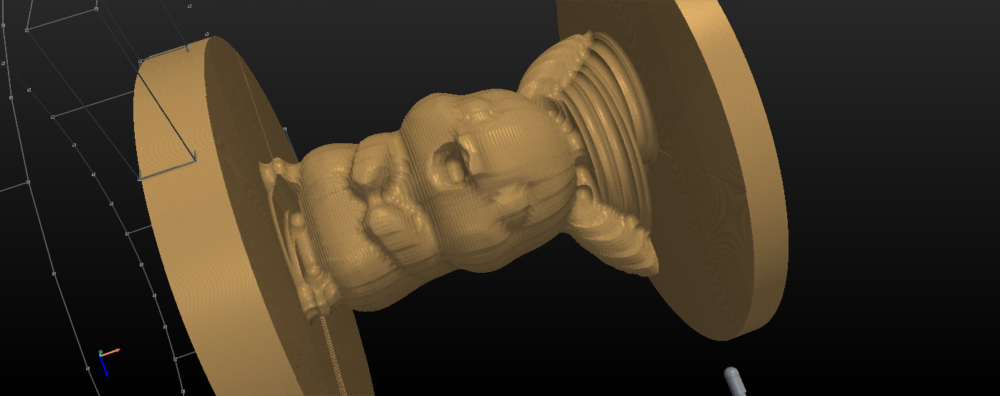
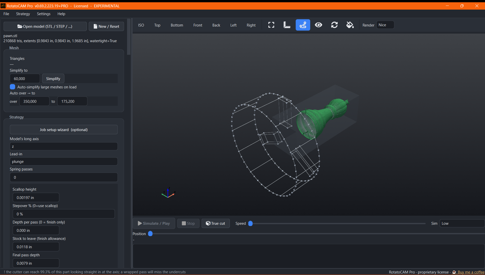
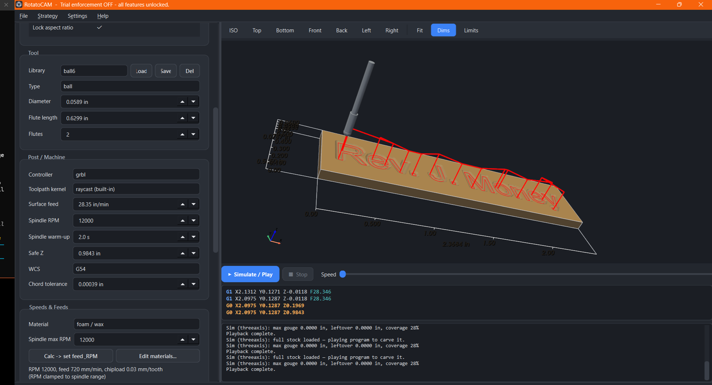

  

# RotatoCAM

**Spin the stock. Read the signal.**

Free (and pro version) 4-axis rotary CAM and G-code generator for DIY CNC. Turn an STL or STEP into
simultaneous 4-axis rotary toolpaths, wrapped engraving, and a verified material-removal
simulation on Windows, without a CAM subscription.

> ⚠️ **EXPERIMENTAL.** RotatoCAM only writes a G-code file; it does not run your machine,
> and its output is only a suggestion you must verify. CNC machines are dangerous. You alone
> are responsible for inspecting every program, air-cutting first, and operating safely.
> Provided AS-IS, with no warranty.

   
  ▶ <b>New here?</b> Watch <a href="https://youtu.be/nLq4axAjO8o">Rotary CNC CAM Made Simple: The RotatoCAM Walkthrough</a>

## Download

Grab the free Community Edition at **[rotatocam.com](https://rotatocam.com/#download)**.
Unzip and run: no install, no license, no expiry.

Everything else lives there too: what it does, the how-to, the gallery, the safe-testing
guide, supported controllers, and RotatoCAM Pro.

   
  ▶ Quick start: <a href="https://youtu.be/-k3qV4LQ3jc">STL to 4-Axis Rotary G-code in Minutes</a>

## Screenshots

### Pikachu rotary simulation

Material-removal simulation showing the Pikachu model between the remaining stock ends.

### Pawn toolpaths

Rotary toolpath preview with the pawn model and chuck fixture in view.

   
  ▶ Watch toolpaths get generated from an STL model (<a href="https://www.youtube.com/shorts/U1BHMhwmi10">Twitch clip</a>)

### Engraving simulation

Engraving playback with the cutter, toolpath, and G-code readout visible.

## See it in action

RotatoCAM on a DIY 4th axis. Click any thumbnail to watch on YouTube.

   
  ▶ <a href="https://youtu.be/NhmXwB_GKhM">Tiki carved in one pass on the rotary</a>

### Rough → spiral finish

Continuous rotary spiral finishing: the A axis keeps turning while the cutter walks along the part.

   
  ▶ <a href="https://youtu.be/-dh9E5Rkhbc">Continuous 4-Axis Rotary Spiral Finishing (grblHAL)</a>

<table>
<tr>
<td align="center" width="50%">
 
Walter White bust, rough → spiral finish
</td>
<td align="center" width="50%">
 
M4 flash hider, rough → spiral finish
</td>
</tr>
<tr>
<td align="center" width="50%">
 
V8 camshaft, rough → spiral finish
</td>
<td align="center" width="50%">
 
🚨 BREAKING NEWS: pushing the rotary to its limits
</td>
</tr>
</table>

### How it started

The first rotary experiments on a DIY 4-axis mini mill, before RotatoCAM had a name.

<table>
<tr>
<td align="center" width="50%">
 
First 4th axis toolpaths on the DIY mini mill
</td>
<td align="center" width="50%">
 
4th axis rotary: milling a spine keychain
</td>
</tr>
</table>

## Why no CAM subscription?

Because some CAM "deals" feel a little like this. A totally fictional undercover documentary:

   
  ▶ <a href="https://youtu.be/kdwuH8-2fAQ">🕵️ UNDERCOVER: The CAM Cartels | Inside the Shady World of Expensive CAM Software</a>

  
  
  
  
   
  Shorts: Undercover with the CAM Cartels · The CAM Smugglers at the Marina · The Laundromat CAM Informant · Monthly CAM Payments at the Motel

Parody. All characters, companies, and product names in it are made up.

## More from the shop

<b>Unlocking locked cutting machines (KillCric open firmware)</b>

 

<table>
<tr>
<td align="center" width="50%">
 
I Cracked Open a Locked CNC Machine: It Runs GPLv3 Software They Won't Release
</td>
<td align="center" width="50%">
 
They Locked This Vinyl Cutter Behind a Cloud, So I Tore It Open
</td>
</tr>
<tr>
<td align="center" width="50%">
 
Turning a Cricut Expression Into a Real CNC Machine
</td>
<td align="center" width="50%">
 
No Account, No Cartridges, No Subscription: KillCric Open Firmware
</td>
</tr>
</table>

Short: [This "locked" machine is secretly open source 🔓](https://www.youtube.com/shorts/wbDPPe3ATIM)

<b>The 3-axis days: 3018 mini mill archive</b>

 

Before the rotary, there was a little 3018. Mostly live streams.

- [Milling The SOA Reaper on a 3018 CNC](https://youtu.be/4LxdE0r-6d0)
- [3018 Toolpath CNC MILLING W Fusion 360 Toolpaths](https://youtu.be/qH6AEFYYP7U)
- [3018 cnc mill and Fusion 360 make a bee thing!](https://youtu.be/jNXKMgR0X5c)
- [3018 Toolpath Simulation in Fusion 360!](https://youtu.be/qRn7Loa1hfc)
- [CNC MILLING a baby sword plaque](https://youtu.be/IBQ5mcxzXYY)
- [CNC MILLING a baby monkey from cherry wood using fusion 360 toolpaths](https://youtu.be/XZt1UUsSoCg)
- [CNC MILLING a cherry wood pipe on the 3018 mini mill](https://youtu.be/x9SGPmoJfKI)
- [CNC MILLING a cherry wood pipe on the 3018](https://youtu.be/RGkWLmDuHZQ)
- [CNC MILLING a pipe from holly wood on the 3018 (stream2)](https://youtu.be/Zu0BtocLtiw)
- [CNC MILLING a pipe from holly wood on the 3018 cnc mill](https://youtu.be/piT8JKVfda8)
- [3018 cnc v carving a sign](https://youtu.be/UFdPQTdqSi0)
- [3018 MILLING SMALL KEYCHAIN TEST](https://youtu.be/-HGXWtMy7EQ)
- [3018 cnc mill live stream, milling random stuff!](https://youtu.be/dqIJ4sGhk_U)
- [3018 cnc milling random stuff](https://youtu.be/DOhWHO6mrDs)
- [3018 cnc milling a monkey from holly wood with fusion 360 toolpaths!](https://youtu.be/bYTPo_8siQI)
- [3018 cnc milling a monkey from holly wood with fusion 360 toolpaths! (another stream)](https://youtu.be/TOtuPRNhYk8)
- [3018 cnc mini milling a monkey mask in wood](https://youtu.be/POthWUIpVA8)
- [live 3018 cnc mill, some Holly Wood, fusion 360!](https://youtu.be/IY1iYGp5Wf0)
- [3018 cnc mill, 3d carving a skull in acrylic rod](https://youtu.be/eBKaGJe5-cI)
- [3018 milling a 5" ashtray from wood cutting board](https://youtu.be/KA2PLKFao38)
- [engraving stuff on the 3018 mini mill/router](https://youtu.be/dCa0X1J-lLY)

More on the channel: **[@REVJMONEY on YouTube](https://www.youtube.com/@REVJMONEY)**

---

Built in Myrtle Beach by Rev. J. Money · **https://rotatocam.com/** · therealrevjmoney@gmail.com
